<div align="center">

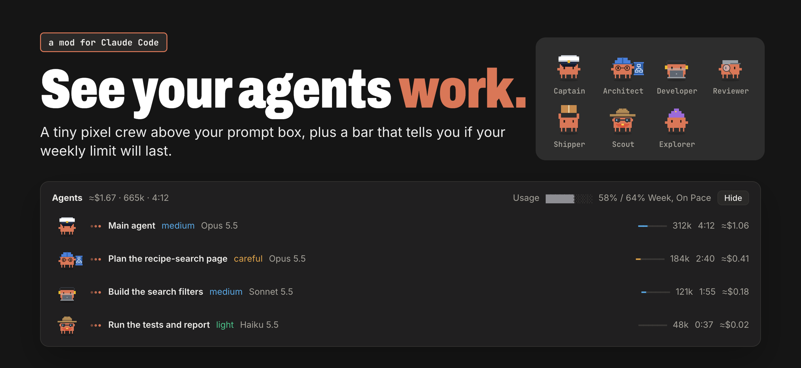

# Claude Agent Panel

**A tiny pixel crew that lives above your prompt box in Claude Code.**
Watch your helper agents work, see what they cost, and know if your weekly limit will last.


[Watch it](#watch-it-work) · [What it does](#what-you-get) · [Install](#install-it-pick-one-way) · [Did it work?](#did-it-work) · [Help!](#something-went-wrong) · [Remove it](#remove-it)

</div>

---

## Watch it work

You ask Claude for help, the crew shows up above the box where you type, and each helper cheers when its job is done.

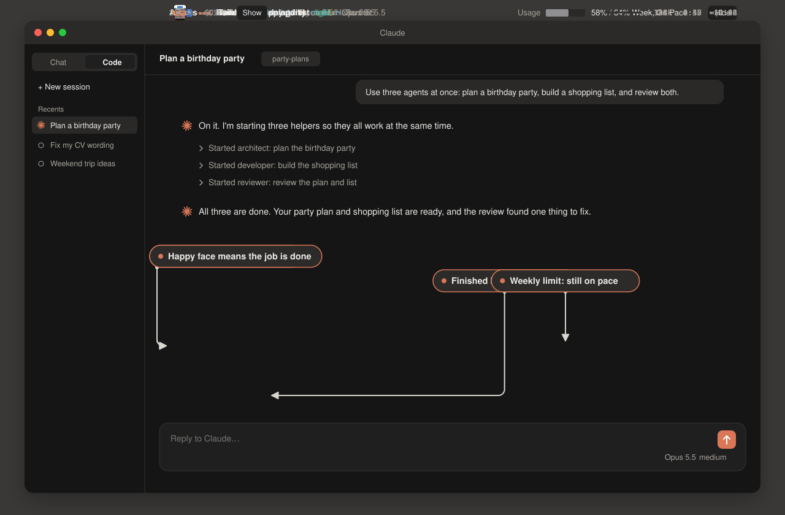

---

## What you get

Two small add-ons (Claude calls them mods) for Claude Code. You install both with one line.

| Mod | What it shows | When you see it |
|---|---|---|
| **Agent panel** | Your crew of agents, what each one is doing, and your weekly usage bar | Always, right above the box where you type |
| **Context band** | How full Claude's memory is, with a one-click tidy-up button | Only when the memory is 60% full or more |

Both work in the Code tab of the Claude desktop app and in Claude Code in the Terminal.

---

## Meet the crew

When Claude hands a job to a helper agent, that helper gets a character. Claude picks the character from words in the job's name.

| | Character | Shows up when the job says... |
|:---:|---|---|
|  | **The Captain** | Always there. This is your main chat. |
|  | **The Architect** | "plan" or "architect" |
|  | **The Developer** | "build" or "develop" |
| 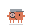 | **The Reviewer** | "review", "verify" or "check" |
|  | **The Shipper** | "ship" or "deploy" |
|  | **The Scout** | "scout" |
|  | **The Explorer** | "explore" |
|  | **The Helper** | Anything else |

They move. The Developer bobs to music with headphones on, the Reviewer sweeps a magnifying glass, and the Shipper hops out the door with a box.

> **Try it:** after you install, type this into Claude and watch the crew appear:
> *"Use three agents at once: one to plan a birthday party, one to build a shopping list, and one to review both."*

---

## How to read the panel

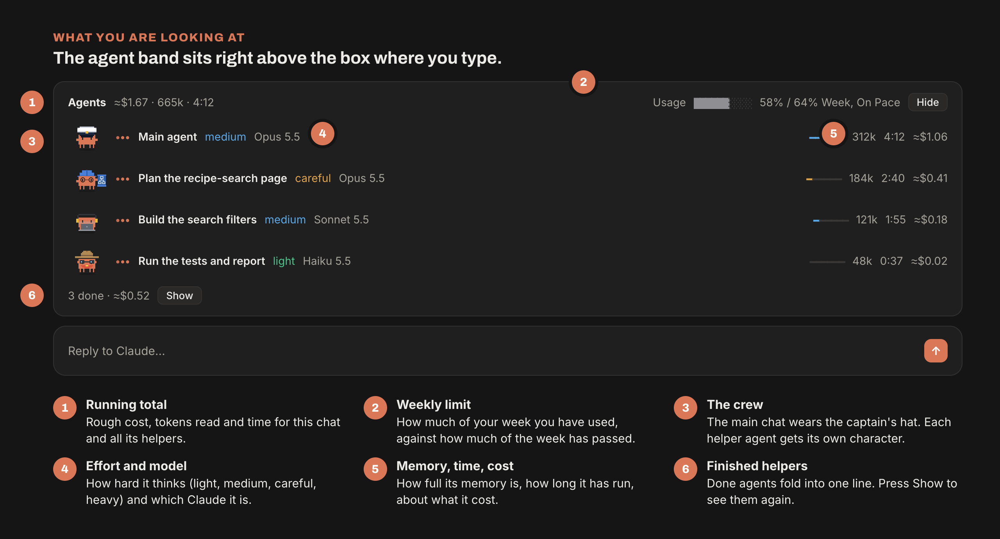

### Read the faces

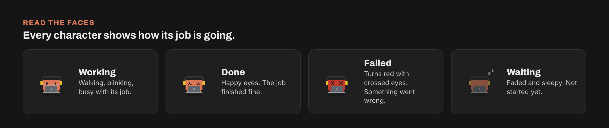

### The weekly bar

Claude Code gives you a weekly allowance. This bar tells you, at a glance, if you are using it too fast.

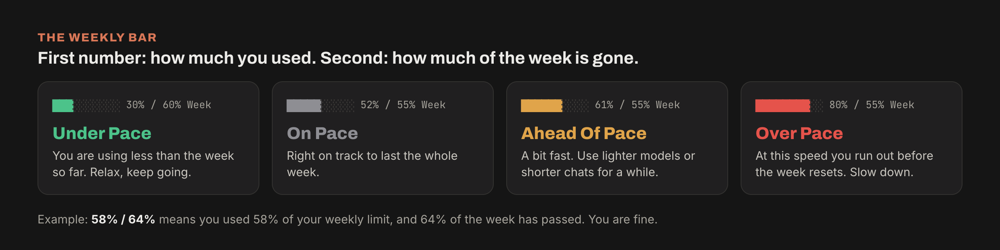

In plain words: if the first number is smaller than the second, you are fine. If it is bigger, slow down a little.

### The context band

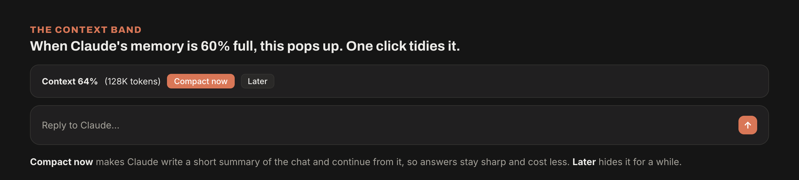

Think of Claude's memory as a notebook. The longer you chat, the fuller it gets, and a full notebook makes Claude slower and pricier. Compact now asks Claude to write a short summary on a fresh page and carry on from there.

---

## Install it (pick one way)

You need the Claude desktop app with a paid plan (Pro or Max). That's it.

### 🛋️ The lazy way: let Claude do it

1. Open the **Claude** app.
2. Click the **Code** tab at the top.
3. Copy the box below. (Hover over it, then click the copy icon on the right.)
4. Paste it into Claude and press **Enter**.
5. If Claude asks for permission to run a command, click **Allow**.

```text
Install the Claude Code mods from github.com/mshadmanrahman/claude-agent-panel for me. Run: claude plugin marketplace add mshadmanrahman/claude-agent-panel, then claude plugin install agent-panel@claude-agent-panel and claude plugin install context-band@claude-agent-panel. Tell me when all three say Successfully.
```

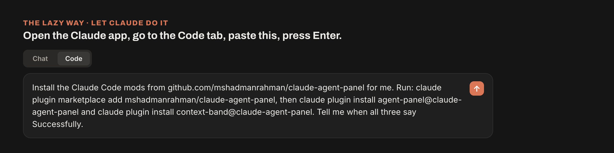

When Claude says all three worked, jump to [Did it work?](#did-it-work)

### ⌨️ The Terminal way (Mac)

Only three steps, and you never have to understand what the words mean.

**Step 1.** Open Terminal.

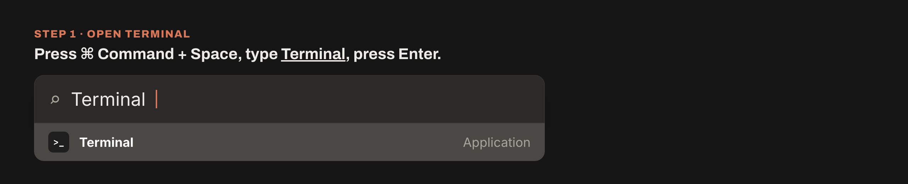

**Step 2.** Copy this line (click the copy icon on the right of the box), paste it into Terminal with **⌘ Command + V**, then press **Enter**.

```bash
claude plugin marketplace add mshadmanrahman/claude-agent-panel && claude plugin install agent-panel@claude-agent-panel && claude plugin install context-band@claude-agent-panel
```

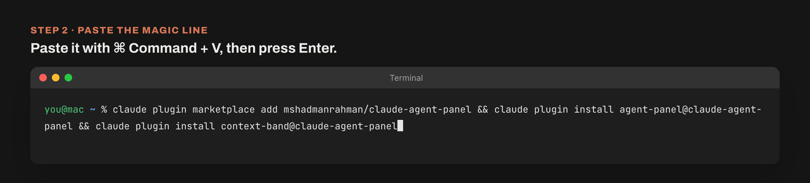

**Step 3.** Wait about ten seconds. Look for three green ticks.

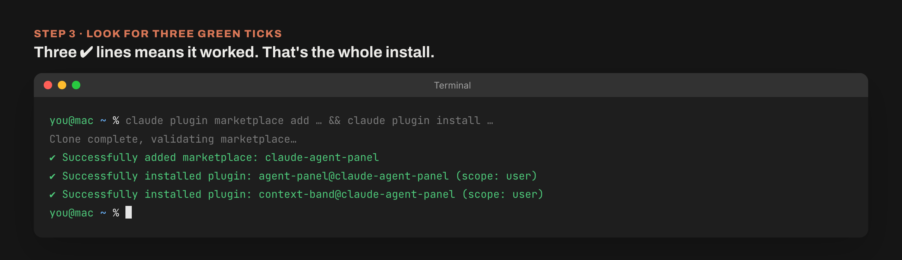

Three ✔ lines means you are done. You can close Terminal.

---

## Did it work?

1. **Quit the Claude app fully** (⌘ Command + Q), then open it again.
2. Go to the **Code** tab and start a new chat.
3. Look just above the box where you type. You should see **Agents** with the Captain, and a **Usage** bar on the right.

No crew? Check the list below.

---

## Something went wrong

| What you see | What to do |
|---|---|
| `zsh: command not found: claude` | Your Mac does not have the Claude Code command yet. Paste this into Terminal, press Enter, wait for it to finish, then close and reopen Terminal and try Step 2 again: `curl -fsSL https://claude.ai/install.sh \| bash` |
| No ticks, a red error instead | Check your internet, then paste the line again. Running it twice is safe. |
| Ticks worked, but no panel | Quit the Claude app with ⌘ Command + Q (closing the window is not enough), open it, start a new chat. |
| The panel is there but the Usage bar is missing | The bar fills in after your first message. Send Claude anything, like "hi". |
| The context band never shows | That's normal. It only appears when Claude's memory is 60% full. |
| The panel takes too much room | Click Hide on the right. Click Show agents to bring it back. |

Still stuck? [Open an issue](https://github.com/mshadmanrahman/claude-agent-panel/issues/new) and paste a screenshot. Or ask your teacher.

---

## Get the newest version

Paste this into Terminal (or ask Claude in the Code tab to run it for you), then restart the app:

```bash
claude plugin marketplace update claude-agent-panel
```

## Remove it

Changed your mind? This takes both mods out. Restart the app afterwards.

```bash
claude plugin uninstall agent-panel@claude-agent-panel && claude plugin uninstall context-band@claude-agent-panel
```

---

<details>
<summary><b>For the curious: how it works</b></summary>

<br>

Claude Code lets you add small programs, called mods, that draw things on screen and listen for events like "an agent started". Each mod here is one TypeScript file:

- [`agent-panel/hooks/register.tsx`](agent-panel/hooks/register.tsx) watches agents start and finish, adds up tokens and time, guesses the cost from public prices, and draws the panel.
- [`context-band/hooks/register.tsx`](context-band/hooks/register.tsx) checks how full the memory is after every turn and shows the band past 60%. Change `const WARN = 60` to move that line.

The costs are estimates with a ≈ sign. Your real bill comes from your Claude plan, not from this panel.

The characters are tiny SVG drawings animated with built-in SVG animation, so they move without slowing anything down.

</details>

<div align="center">
<br>

Made by [Shadman Rahman](https://github.com/mshadmanrahman) for his students. Share it with yours.

</div>
